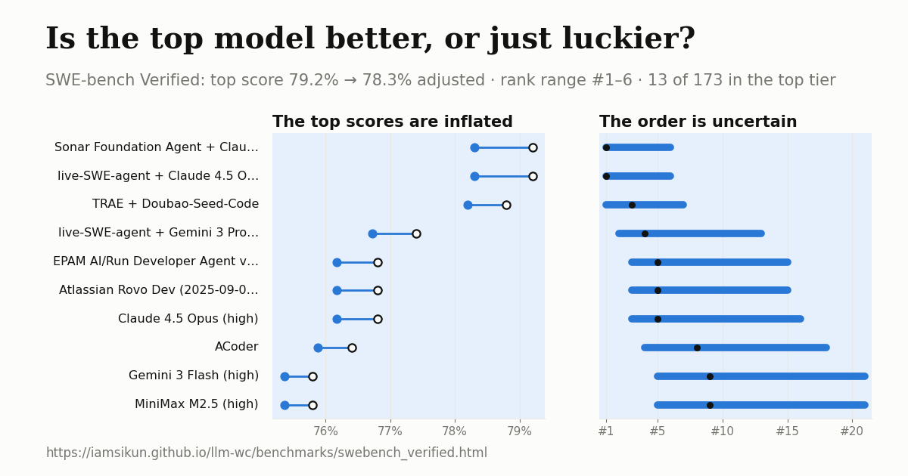

# SOTA or Luck? The winner's curse and rank uncertainty in LLM leaderboards

**Is the top model better, or just luckier?** A leaderboard score is measured on
a finite set of tasks, so part of it is luck. Sorting models by score rewards
that luck: the top scores come out inflated, and the order is less certain than
it looks. This repository measures both effects for any leaderboard where you
have per-task results.

**Website:** [sikunxu.com/llm-wc](https://sikunxu.com/llm-wc/) tracks these
effects on public leaderboards and updates monthly.

**Paper:** [SOTA or Luck? The Winner's Curse in LLM Leaderboards](https://arxiv.org/abs/2611.22227)
(Xu, Thomadsen, Zhang, Zhang, arXiv:2611.22227).



*SWE-bench Verified, 173 systems on 500 tasks. The top score of 79.2% adjusts to
78.3%. The two systems tied for #1 could each rank anywhere from #1 to #6, and
13 systems share the top tier.*

## What it does

Given a task × model matrix of scores, the library

- **corrects the rank-induced bias.** An m-out-of-N bootstrap estimates how much
  sorting inflates the score at each leaderboard position (or deflates it near
  the bottom) and subtracts it.
- **reports the rank uncertainty that remains, as RULER:** a rank probability
  matrix (how likely each model is to hold each rank), rank-mass intervals for
  each model, and tiers of models the tasks cannot order.

The repository also contains parsers that turn public leaderboards (SWE-bench,
SWE-bench Pro, Tau2-Bench, AlpacaEval 2, WildBench, LiveBench) into such
matrices, frozen snapshots of those leaderboards, the validation experiments,
and the website.

## Quick start

Requires Python 3.13+ and [uv](https://docs.astral.sh/uv/).

```bash
uv sync --all-groups
uv run pytest
```

Run RULER on your own leaderboard. `obs` has one row per task and one column
per model:

```python
import numpy as np
from llm_wc.wc.ruler import ruler

obs = np.load("my_leaderboard.npy")      # (n_tasks, n_models), e.g. 0/1 pass results
r = ruler(obs)                           # m = floor(N^0.9), 5000 bootstraps, seed 42

r.scores - r.adjustment                  # bias-adjusted scores, best first
r.intervals[0.2][:2]                     # 80% rank intervals (low, high)
r.tiers[0.2]                             # tiers of models the tasks cannot order
r.rpm                                    # rank probability matrix
```

Or start from one of the bundled snapshots:

```python
from llm_wc.benchmarks import load_setting

obs = load_setting("swebench_verified").obs   # (500 tasks, 173 models)
```

[docs/methods/bootstrap_correction.md](docs/methods/bootstrap_correction.md) explains the method.
`llm_wc.wc.core.bootstrap_correction` adds cluster, wild-cluster and stratified
bootstraps for tasks that are not independent.

## Leaderboard tracker and website

`src/llm_wc/tracker/` keeps RULER reports for public leaderboards current and builds the
project website. It refreshes the data monthly and lets you browse each leaderboard's adjusted
scores, rank probabilities, and tiers. Each leaderboard also keeps a frozen reference edition:
the pinned snapshot in `resources/`, analyzed exactly as in `results/ruler_audit/`.

```bash
uv sync --group tracker
uv run python -m llm_wc.tracker build && uv run python -m llm_wc.tracker serve
```

See [docs/tracker.md](docs/tracker.md) (data format, sources, adding a leaderboard, publishing).

## Layout

```
src/llm_wc/
  wc/             bias correction and RULER (ruler.py, core.py)
  benchmarks.py   the 14 reference leaderboard settings
  parsers/        leaderboard parsers (with scripts/parsers/)
  simulation/     calibrated simulation (with dgp/ for long-format data)
  tracker/        leaderboard tracker and website builder
scripts/          experiments (run_*.py), parsers/
resources/        frozen leaderboard snapshots
results/          committed outputs of the experiment scripts
tracker/          tracker registry, live snapshots and reports, website templates
notebooks/        paper.ipynb: replication notebook
docs/             methods, data sources, parsers, tracker, developer notes
```

## Replication

[`notebooks/paper.ipynb`](notebooks/paper.ipynb) runs the seven experiment scripts (about eight
minutes), writes every table and figure to `notebooks/output/`, and recomputes each reported
number. The committed `results/` are the outputs of those scripts, so a rerun should leave
`git diff results/` empty.

```bash
uv sync --all-groups
uv run jupyter nbconvert --to notebook --execute --inplace notebooks/paper.ipynb
```

## Citation

```bibtex
@misc{xu2026sota,
  title         = {{SOTA} or Luck? The Winner's Curse in {LLM} Leaderboards},
  author        = {Xu, Sikun and Thomadsen, Raphael and Zhang, Dennis J. and Zhang, Heng},
  year          = {2026},
  eprint        = {2611.22227},
  archivePrefix = {arXiv},
  primaryClass  = {cs.LG},
  doi           = {10.48550/arXiv.2611.22227},
  url           = {https://arxiv.org/abs/2611.22227}
}
```

## Data and license

The code is under the [MIT License](LICENSE). The leaderboard data in `resources/` and
`tracker/data/` keeps its upstream licenses; see
[docs/data_sources.md](docs/data_sources.md#licenses).
